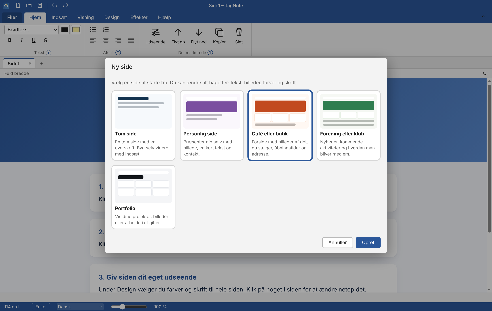
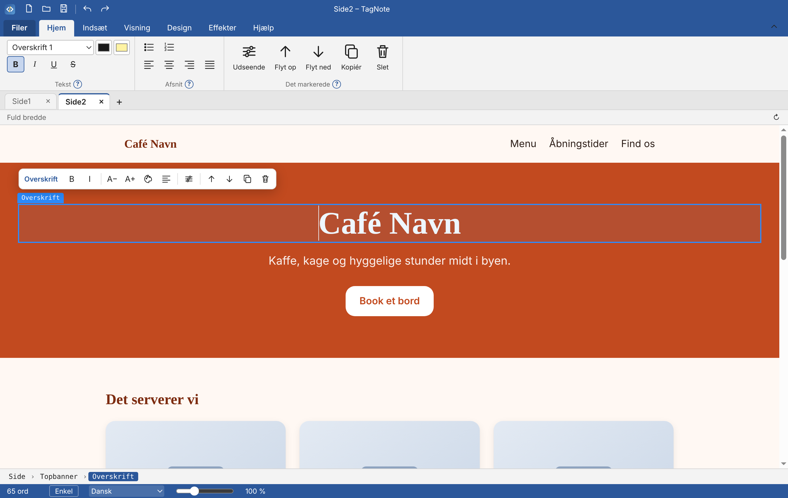
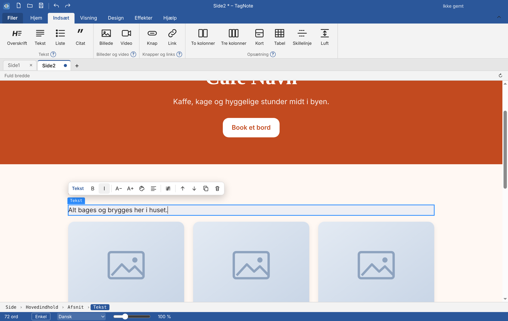
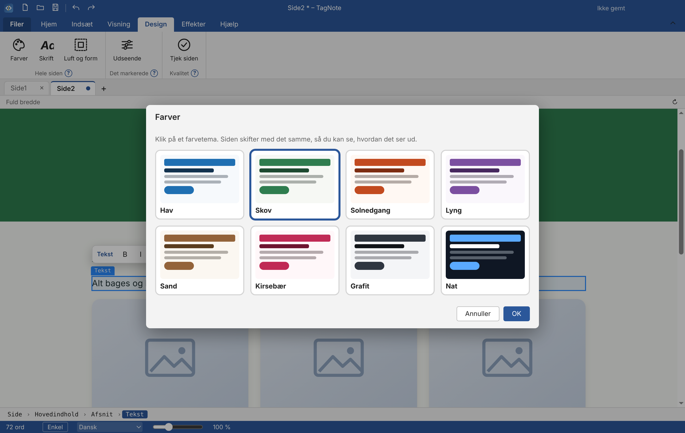
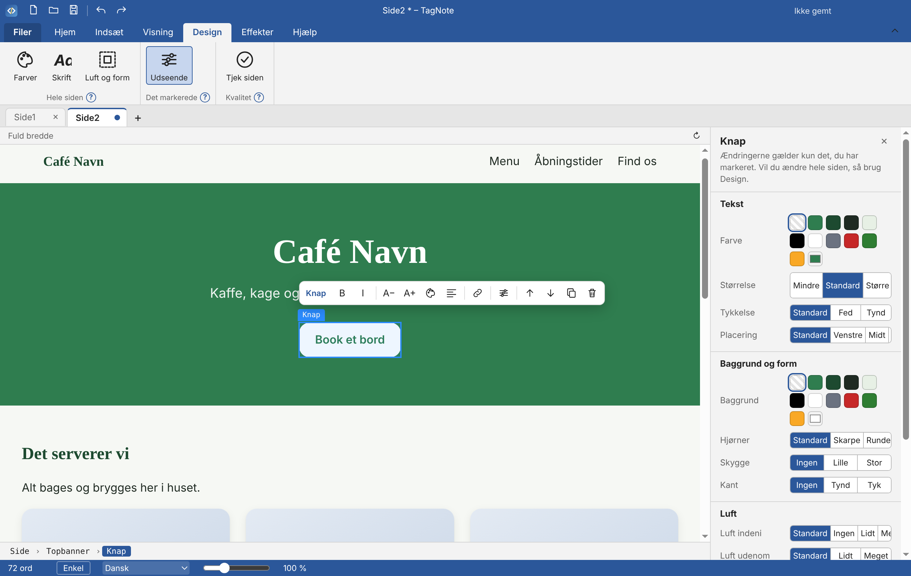
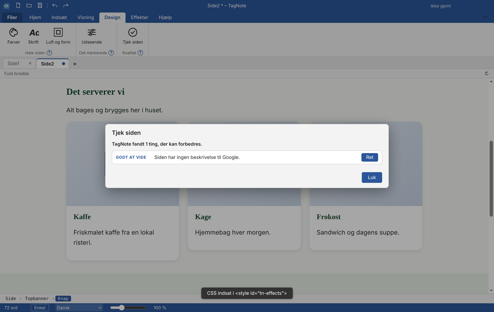
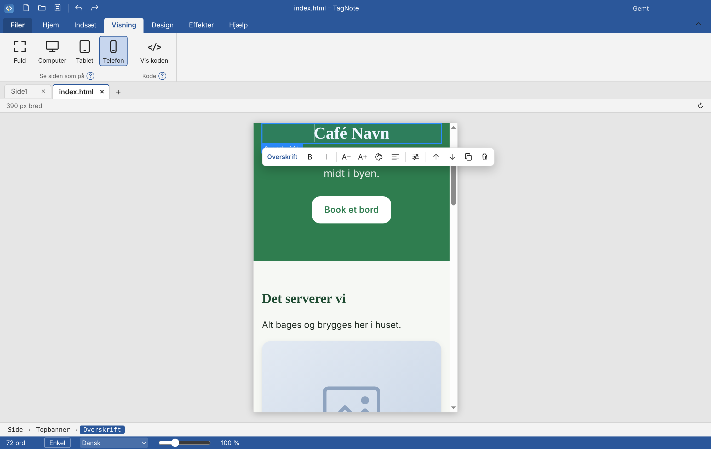
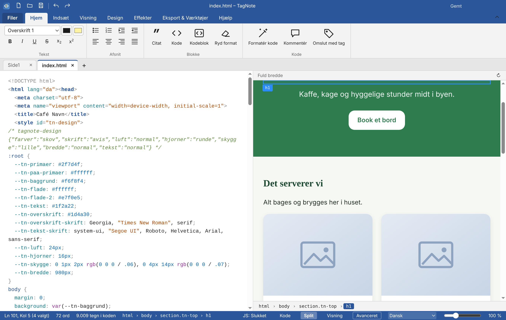
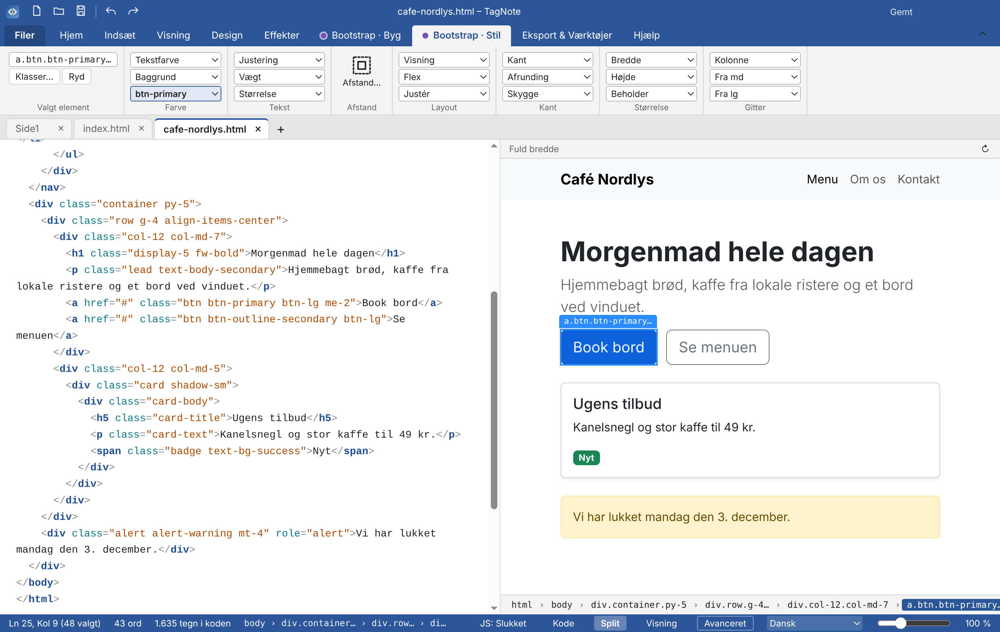

# TagNote

A Word-style HTML editor and viewer for Windows 10 and 11. A sister program to [MarkNote](https://github.com/Cphmartinus/marknote).

TagNote lets anyone make a website, also without knowing HTML, CSS or JavaScript. Start from a ready-made page, type straight into it as in Word, add pictures, buttons and columns, and choose colours and fonts for the whole page. Your website is a plain folder with `index.html` and its pictures. No lock-in, no account, no telemetry.

When you want more, switch to **Advanced** to see the code and use all the tools: source editing with colour highlighting, framework tabs for Bootstrap, Tailwind CSS, Bulma and Pico, a style panel, JavaScript in the preview, and more export formats.



| | |
| --- | --- |
|  |  |
|  |  |
|  |  |
|  |  |

## Features

### Simple (default)

- **Templates:** an empty page, a personal page, a café or shop, a club and a portfolio.
- **Type in the page** as in Word. Click something to select it; the breadcrumbs below show where you are (Page › Top banner › Heading).
- **Insert:** heading, text, list, quote, picture, video (YouTube, Vimeo), button, link, two or three columns, cards, table, divider and space. New parts go just below what you clicked.
- **Small toolbar** next to the selection: bold, italic, smaller and larger text, colour, alignment, look, move up and down, copy, delete. Double-click a picture to change it.
- **Design for the whole page:** colour themes, fonts, space, corners, shadow and page width. **Look** changes only the selected part.
- **Effects:** slide in on scroll, hover effects, repeating motion, gradients, shadows, glass, pin to top and a reading bar, applied to the selection.
- **Save as a website:** the first save creates a folder with `index.html` and a `billeder` folder for pictures. Pictures are copied in automatically, so they always work.
- **Check the page** in plain language, with **Fix** for missing title, language, description and picture descriptions.
- **Help on the spot:** a short tour, a **?** on every ribbon group, and Save as PDF and earlier versions under File.

### Advanced

- **Three views:** HTML source with colour highlighting, source and live preview side by side, and the page at full size. Preview widths for desktop, tablet and phone.
- **Edit in the preview** and the change is written back to the code. Click in the code and the matching element is highlighted in the page.
- **Safe by default:** the preview runs in an isolated frame and no script in the page runs. Turn JavaScript on per file, or choose *Known* to allow only scripts from known libraries.
- **Style panel** for the selected element, written as inline style or as a rule for the class, id or tag.
- **Framework tabs** for Bootstrap, Tailwind CSS, Bulma and Pico: components, grid builder, class pickers with margin and padding box, breakpoints. Class lists are read from the frameworks' own CSS (`npm run catalogs`).
- **Effects and design tools** with live demos and plain CSS output, a colour palette in OKLCH, fluid sizes with `clamp()`, CSS variables and font pairs.
- **Code tools:** auto-close tags, auto-indent, format code, comment in and out, wrap in tag, find and replace with regular expressions, outline panel.
- **Export:** PDF, clean HTML, Markdown (for MarkNote) and plain text.

Built on Electron 45 (Chromium 156), so modern CSS works in the preview.

## Download

Get the latest Windows build from the [Releases page](https://github.com/Cphmartinus/tagnote/releases/latest):

- `TagNote-Setup-<version>.exe` (**recommended**): installs TagNote, opens `.html` files with a double-click, and can install later updates from *Help → Search for updates*. Install it over an earlier version; your settings are kept.
- `TagNote-<version>-portable.exe`: runs without installation. It unpacks itself on every start, so it starts more slowly.

The executables are not code-signed, so Windows SmartScreen may show a warning the first time. Choose **More info → Run anyway**. Releases are built from this repository by GitHub Actions, see [`.github/workflows/build.yml`](.github/workflows/build.yml).

## How the preview works

The program and the preview are served from one custom scheme (`tagnote://app/`). The page is shown in an `iframe`:

| JavaScript | `sandbox` | Visual editing |
| --- | --- | --- |
| Off (default) | `allow-same-origin` plus a CSP with `script-src 'none'` | yes |
| Known | `allow-scripts` plus a CSP that lists the exact script addresses | no |
| On | `allow-scripts` (no same origin) | no |

Relative paths (images, stylesheets, fonts) resolve like in a browser. Files a script could run or read (`.js`, `.json`, `.html`, `.svg`, `.txt`) are only served from the document's own folder and subfolders.

## Build from source

Requires [Node.js](https://nodejs.org/) 22.12 or newer.

```bash
npm install
npm start
```

`npm install` copies the browser libraries to `renderer/vendor`. `npm run catalogs` regenerates the class lists in `renderer/catalog` from the installed Bootstrap, Bulma and Pico packages. `npm run check` checks the scripts and translation files. `npm run dist` builds the Windows installer and portable executable (the installer needs Windows, or Wine on Linux).

## Languages

Danish and English are complete. Texts that TagNote shares with MarkNote are translated into all 13 languages (Danish, English, German, French, Spanish, Italian, Dutch, Portuguese, Polish, Swedish, Norwegian, Finnish, Icelandic). The other languages show English for the texts that are new in TagNote.

## Limits

- Visual editing rewrites the HTML in standard form (attribute quotes, entities, void tags) for the page, not only the part you changed. Use the source view when exact formatting matters.
- Frameworks loaded from a CDN need an internet connection in the preview. For offline use, link a local copy.
- Visual editing and the style panel need JavaScript to be off, because scripts can change the page while you edit it.
- The interface texts that are new in TagNote are in Danish and English. In the other 11 languages they are shown in English.

## License

[MIT](LICENSE). Uses [js-beautify](https://github.com/beautifier/js-beautify) and [Turndown](https://github.com/mixmark-io/turndown), both MIT.
