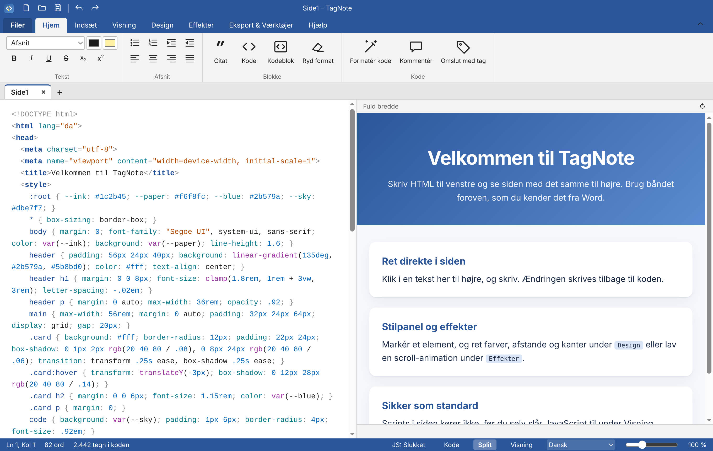
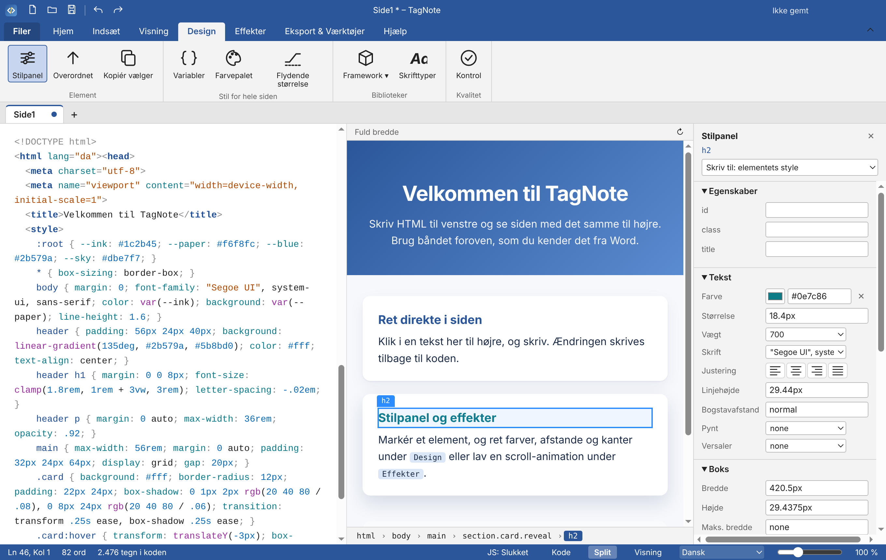
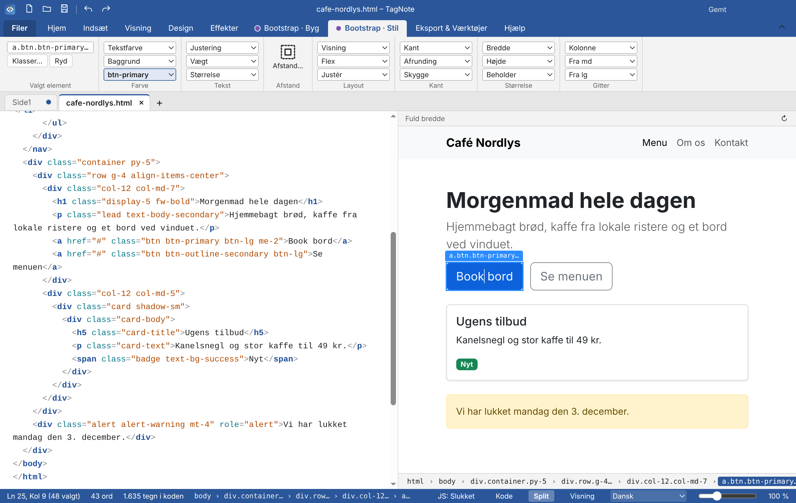
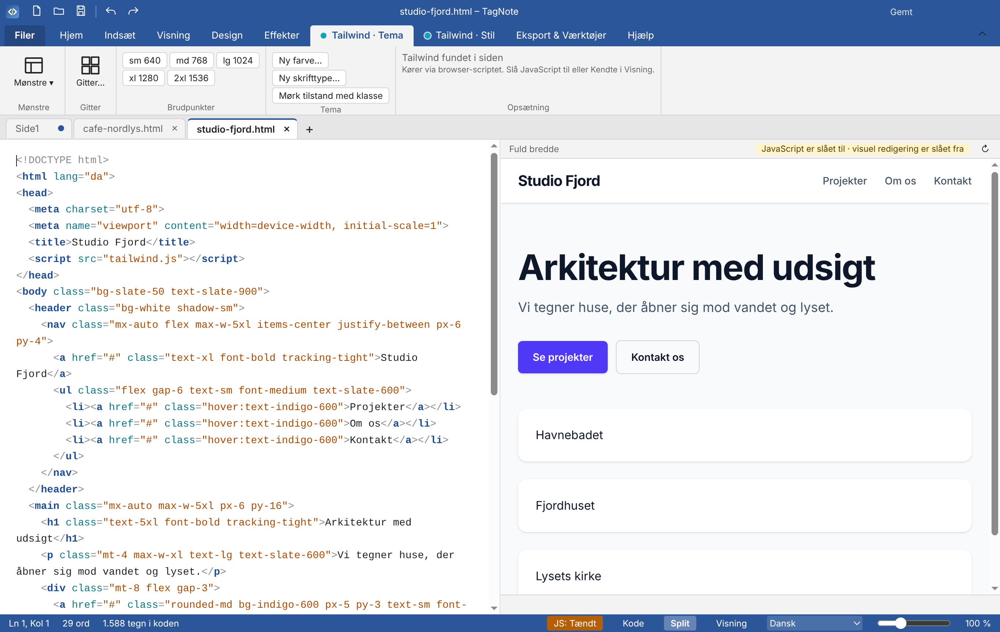
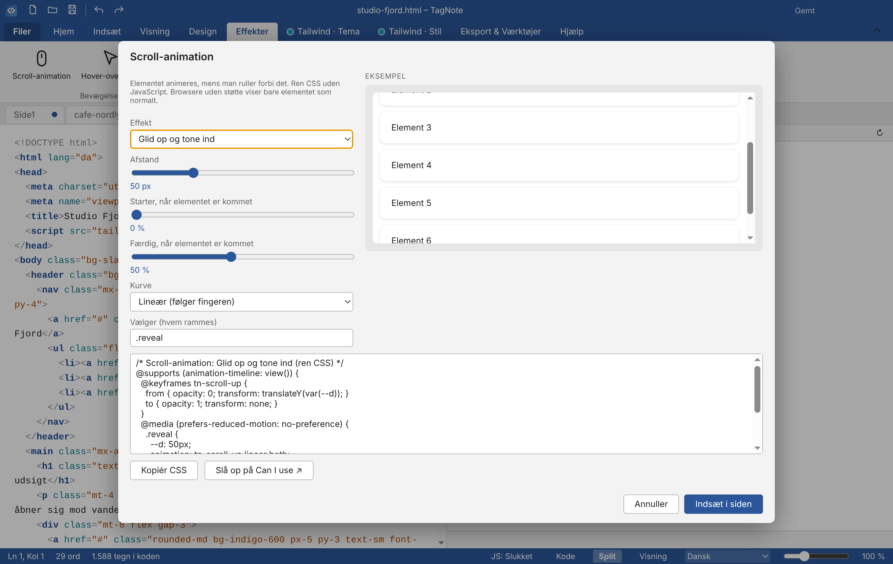
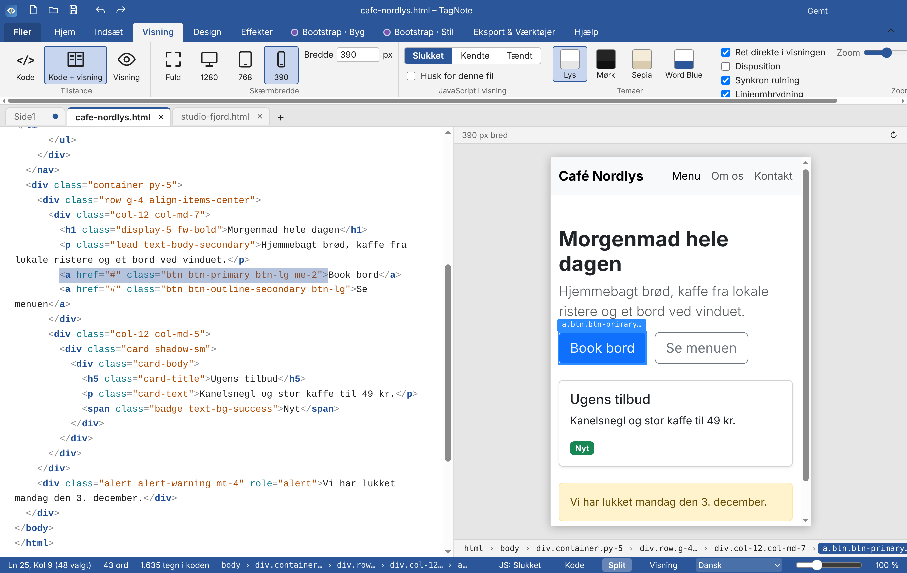
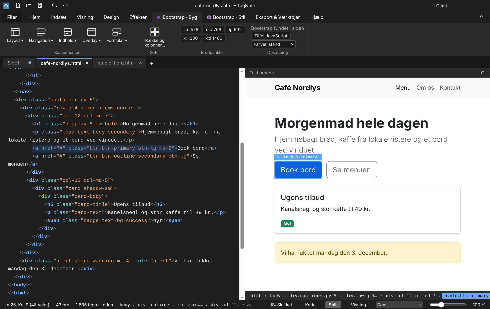

# TagNote

A Word-style HTML editor and viewer for Windows 10 and 11. A sister program to [MarkNote](https://github.com/Cphmartinus/marknote).

TagNote gives you the familiar ribbon, title bar, tabs and status bar of a word processor, while your documents stay plain `.html` files. See the page as you write it, edit text directly in the preview, and get help with CSS, frameworks and modern effects. No lock-in, no account, no telemetry.




| | |
| --- | --- |
|  |  |
|  |  |
|  |  |

## Features

- **Three views:** HTML source with colour highlighting, source and live preview side by side, and the page at full size. Preview widths for desktop, tablet and phone.
- **Edit in the preview:** click an element to select it (breadcrumbs show where you are), type directly in the page, and the change is written back to the code. Click in the code and the matching element is highlighted in the page.
- **Safe by default:** the preview runs in an isolated frame and no script in the page runs. Turn JavaScript on per file when you trust it, or choose *Known* to allow only scripts from known libraries (Bootstrap, Tailwind and others).
- **Style panel:** colours, text, spacing, borders and layout for the selected element, written as inline style or as a rule for the class, id or tag.
- **Framework tabs:** when TagNote finds Bootstrap, Tailwind CSS, Bulma or Pico in the page, extra tabs appear. Bootstrap, Tailwind and Bulma get *Build* and *Style* tabs (components, grid builder, class pickers with margin and padding box, breakpoints). Pico gets one tab (theme, components). Class lists are read from the frameworks' own CSS (`npm run catalogs`).
- **Effects:** scroll animations (`animation-timeline`), hover transitions, keyframe animations, gradients, layered shadows, glass, scroll snap, sticky elements, reading progress. Each has a live demo and produces plain CSS in a marked `<style id="tn-effects">` block, wrapped for `prefers-reduced-motion`.
- **Design tools:** colour palette in OKLCH, fluid sizes with `clamp()`, CSS variables editor, font pairs, page check (alt texts, title, language, duplicate ids, unknown framework classes).
- **Insert:** tables, images, links, sections, forms, media, meta tags, stylesheets, scripts, symbols, a blank HTML5 page.
- **Code tools:** auto-close tags, auto-indent, format code, comment in and out, wrap in tag, find and replace with regular expressions, outline panel.
- **Export:** PDF, clean HTML, Markdown (for MarkNote) and plain text. Tabs, version history with automatic snapshots, themes (Light, Dark, Sepia, Word Blue).

Built on Electron 45 (Chromium 156), so modern CSS works in the preview.

## How the preview works

The program and the preview are served from one custom scheme (`tagnote://app/`). The page is shown in an `iframe`:

| JavaScript | `sandbox` | Visual editing |
| --- | --- | --- |
| Off (default) | `allow-same-origin` plus a CSP with `script-src 'none'` | yes |
| Known | `allow-scripts` plus a CSP that lists the exact script addresses | no |
| On | `allow-scripts` (no same origin) | no |

Relative paths (images, stylesheets, fonts) resolve like in a browser. Files a script could run or read (`.js`, `.json`, `.html`, `.svg`, `.txt`) are only served from the document's own folder and subfolders.

## Build from source

Requires [Node.js](https://nodejs.org/) 22.12 or newer.

```bash
npm install
npm start
```

`npm install` copies the browser libraries to `renderer/vendor`. `npm run catalogs` regenerates the class lists in `renderer/catalog` from the installed Bootstrap, Bulma and Pico packages. `npm run dist` builds a Windows portable executable.

## Languages

Danish and English are complete. Texts that TagNote shares with MarkNote are translated into all 13 languages (Danish, English, German, French, Spanish, Italian, Dutch, Portuguese, Polish, Swedish, Norwegian, Finnish, Icelandic). The other languages show English for the texts that are new in TagNote.

## Limits

- Visual editing rewrites the HTML in standard form (attribute quotes, entities, void tags) for the page, not only the part you changed. Use the source view when exact formatting matters.
- Frameworks loaded from a CDN need an internet connection in the preview. For offline use, link a local copy.
- Visual editing and the style panel need JavaScript to be off, because scripts can change the page while you edit it.

## License

[MIT](LICENSE). Uses [js-beautify](https://github.com/beautifier/js-beautify) and [Turndown](https://github.com/mixmark-io/turndown), both MIT.
